<p align="center">
  
</p>

<p align="center">
  <strong>Your Mac assistant with a voice, and a digital company that does the work.</strong><br>
  Talk to XENIO, and it acts on your Mac. Give the War Room one sentence, and a team of AI agents builds it, tests it in a sandbox, reviews it, and hands it back running. You stay the CEO: anything risky waits for your yes.
</p>

<p align="center">
  <a href="https://github.com/tanishqnarula12/Xenio/actions/workflows/ci.yml"></a>
  <a href="https://github.com/tanishqnarula12/Xenio/stargazers"></a>
  <a href="https://github.com/tanishqnarula12/Xenio/commits/main"></a>
  <a href="LICENSE"></a>
  
  
  
</p>

<p align="center">
  <a href="#watch-it-work">Demo</a> ·
  <a href="#the-war-room">The War Room</a> ·
  <a href="#what-is-verified-and-what-is-not-yet">What works today</a> ·
  <a href="docs/INSTALLATION.md">Install</a> ·
  <a href="docs/ARCHITECTURE.md">Architecture</a> ·
  <a href="docs/SECURITY_MODEL.md">Safety</a> ·
  <a href="docs/ROADMAP.md">Roadmap</a>
</p>

---

## Watch it work

<p align="center">
  <a href="docs/media/xenio-demo.mp4">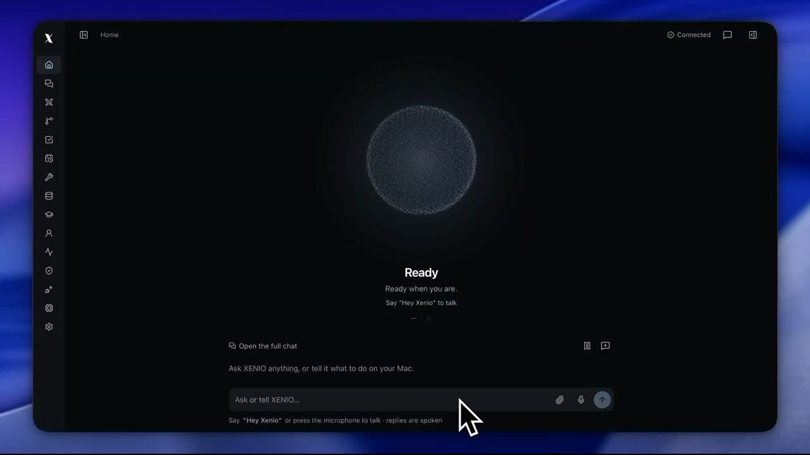</a><br>
  <sub><b>▶ Two-minute demo</b> (<a href="docs/media/xenio-demo.mp4">xenio-demo.mp4</a>): home, chat, the War Room, skills, memory, the profile vault and settings. Personal details in it are blurred.</sub>
</p>

## The idea

Talk naturally. XENIO handles the voice, your desktop, approvals and the interface. [Hermes Agent](https://github.com/NousResearch/hermes-agent) is the assistant that reasons in the chat, and the War Room runs a whole team of agents for bigger work. Every action that touches your Mac or leaves it passes XENIO's safety policy first.

```text
  your voice / chat ──► XENIO ──► Hermes Agent ──► tools & skills
                          │
                          ├──► the War Room ──► planner · engineers · tester · reviewers
                          │                        (each in an isolated copy, code in a sandbox)
                          ▼
                 safety policy + your approvals ──► spoken reply / finished work
```

## The War Room

Your digital company. You are the CEO, XENIO is the manager, and the agents do the work. Every screenshot below is from one real job, run start to finish on real models: *build a habit tracker with a FastAPI backend, a SQLite database and a weekly streak chart*.

**1. One sentence starts it.** Give the command, and set limits if you want them: the most tokens for the whole job, and for one agent's task.

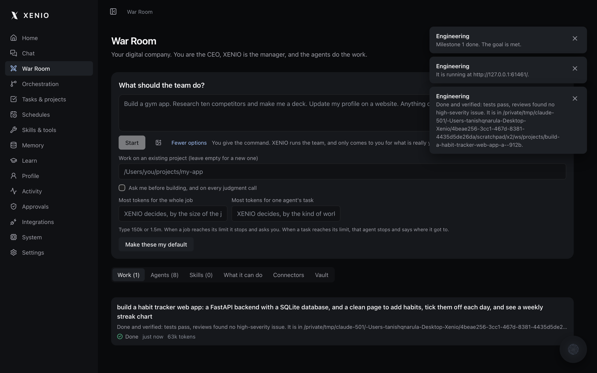

**2. XENIO assembles the team.** Each agent works in its own isolated copy of the project. A small or medium job is done end to end by one builder, so nothing is lost in hand-overs; reviewers and a tester check the work. You can watch each one, and message any of them while they work.

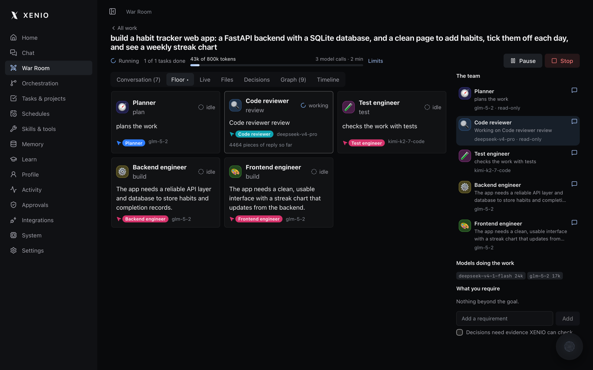

**3. They report as they go, and the checks are XENIO's, not the agents'.** XENIO runs the tests itself, in the macOS sandbox. A security reviewer and a code reviewer read the change independently, pointing at real lines.

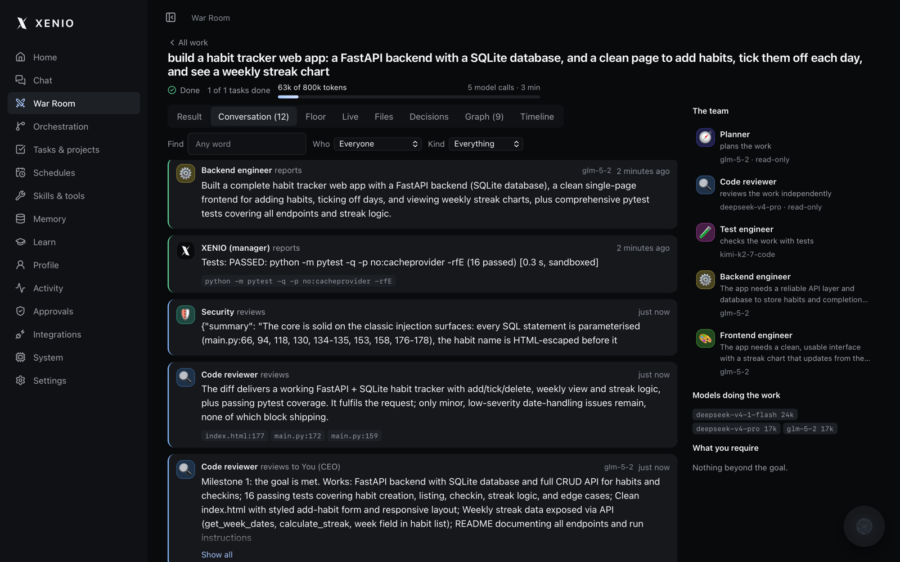

**4. Test, review, fix, until it is clean.** Every round is shown. Here round 1 passed all 16 tests, the review was clean, and an independent check confirmed the goal was met.

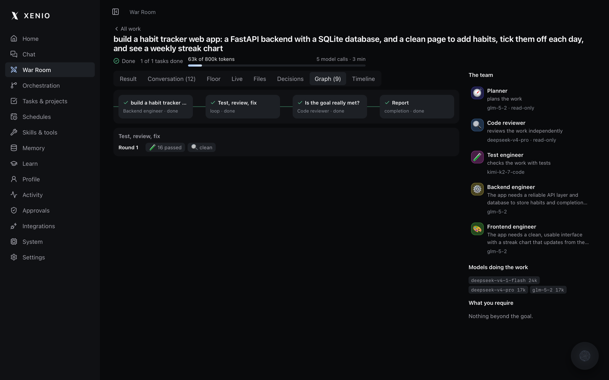

**5. It comes back running and verified.** The app starts inside the War Room for you to try. One click puts it on your GitHub (private by default); nothing is ever force-pushed.

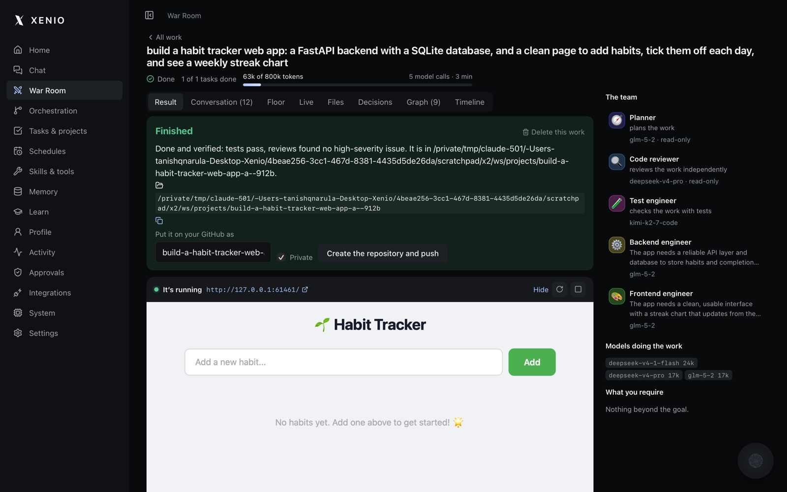

**What the team built,** in 3 minutes and 62,700 tokens, and used by hand afterwards: habits stored in SQLite, ticked off by day, with real streaks.

<p align="center">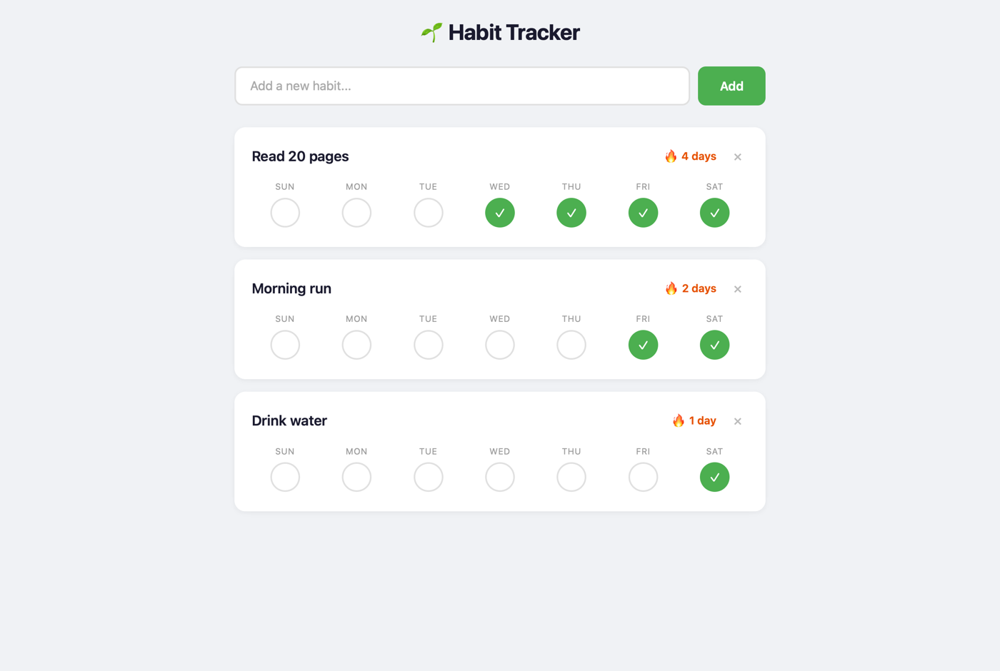</p>

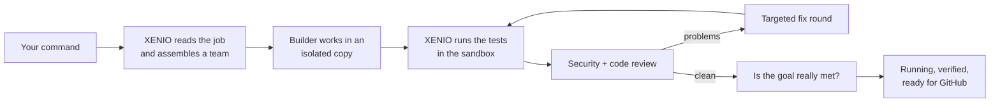

**What XENIO can really do right now** is found by asking the Mac, never assumed: if something is missing, the job says what would fix it before a token is spent.

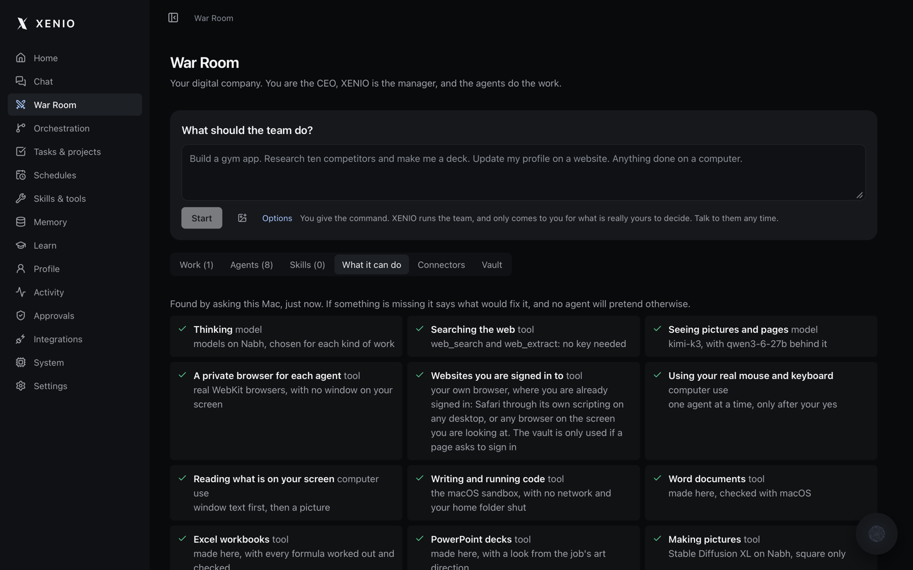

<details>
<summary><b>The agents</b></summary>

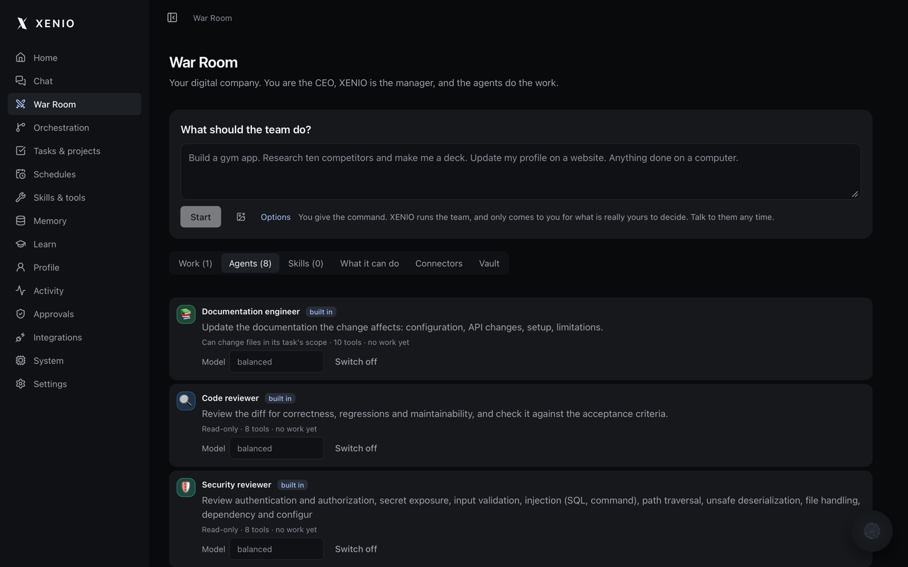

Built-in roles (planner, engineers, tester, reviewers, documentation) plus specialists XENIO creates for a job. Reviewers are read-only. Only you can widen an agent's permissions.
</details>

**Beyond code:** research and reports (Word, Excel, PowerPoint, checked when made), work on websites in your own Safari where you are already signed in, designs in Figma through XENIO's plugin, and any service you connect over MCP. Passwords go into a vault agents can use but never read. More in [WAR_ROOM.md](docs/WAR_ROOM.md).

## Everything else XENIO does

|  |  |
|---|---|
| **Talk, then keep talking**<br>Wake word, interruption, follow-up listening, and replies spoken as they arrive. | **A real desktop companion**<br>Open and control apps, work with files and windows, play music, and see what XENIO is doing. |
| **Approvals where they matter**<br>Permission checks sit in front of every tool action; risky actions need a clear yes, and some are blocked. | **Mission Control**<br>Conversation, voice orb, tasks, projects, schedules, memory, activity and pending approvals in one place. |
| **Fast without a model round-trip**<br>Common commands like opening apps, volume, music and time use a fast path. | **Learn anything**<br>The Teacher explains in the chat, step by step, with diagrams and follow-ups. |

## How it works

### 1. You talk or type

The same path serves the voice orb, the chat and the terminal. Simple commands never wait for a model, and nothing is said to be done until XENIO's own records show it was.

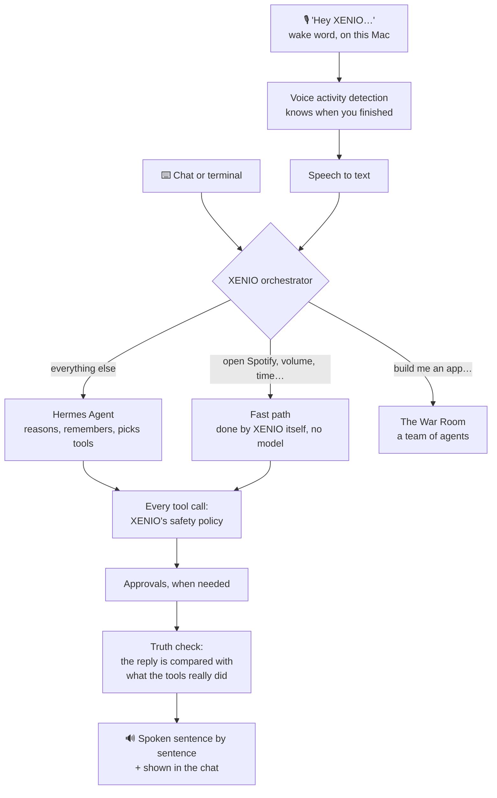

A reply that claims "Done" when a tool failed is replaced with what really happened, before it is ever spoken.

**Home** is the orb, a quick chat, and everything at a glance: the last job to pick up, what is running, your tasks, what is coming up, and how healthy each part of XENIO is.

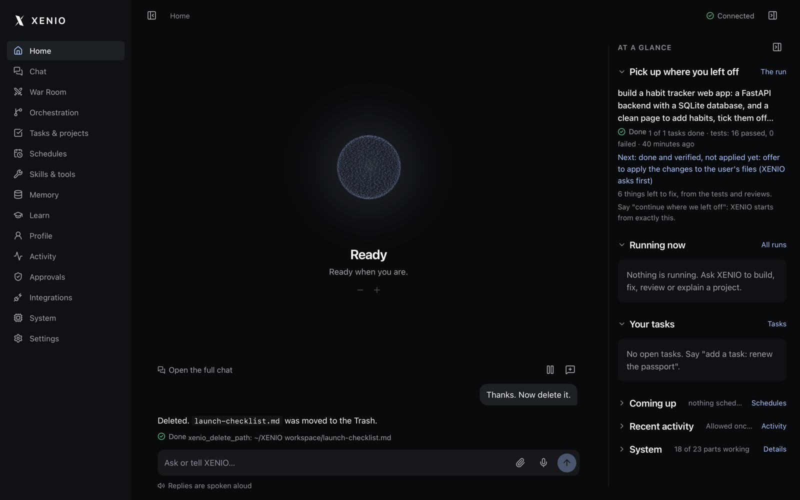

### 2. You stay in control

Every action is classified before it runs. The more it can change, the more XENIO needs from you, and anything unclear counts as **no**.

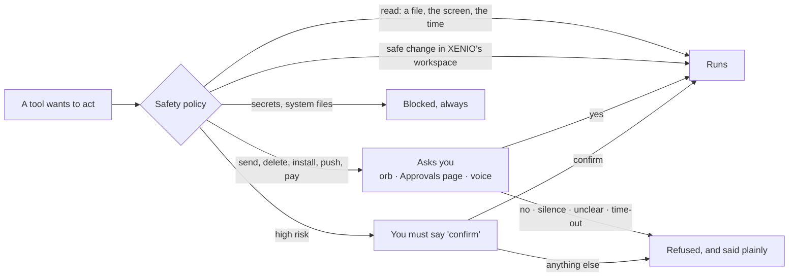

The same policy runs inside Hermes through the `xenio-guard` plugin, so an action cannot go around XENIO by going through Hermes. Every decision is kept in **Activity**.

One real conversation, start to finish. XENIO writes a file in its workspace without asking: that is a safe change. Then you ask it to delete the file, and it stops and asks you first, saying why:

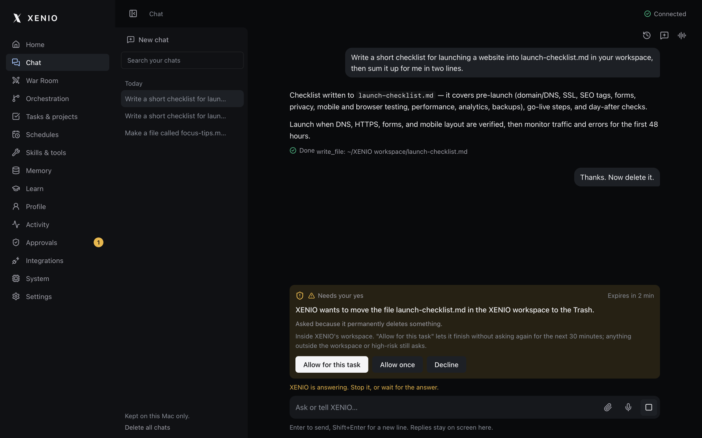

<table>
<tr>
<td width="50%">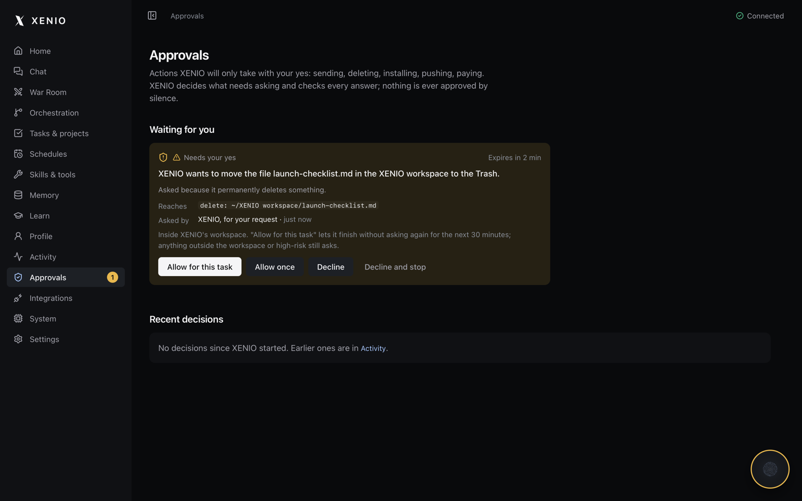</td>
<td width="50%">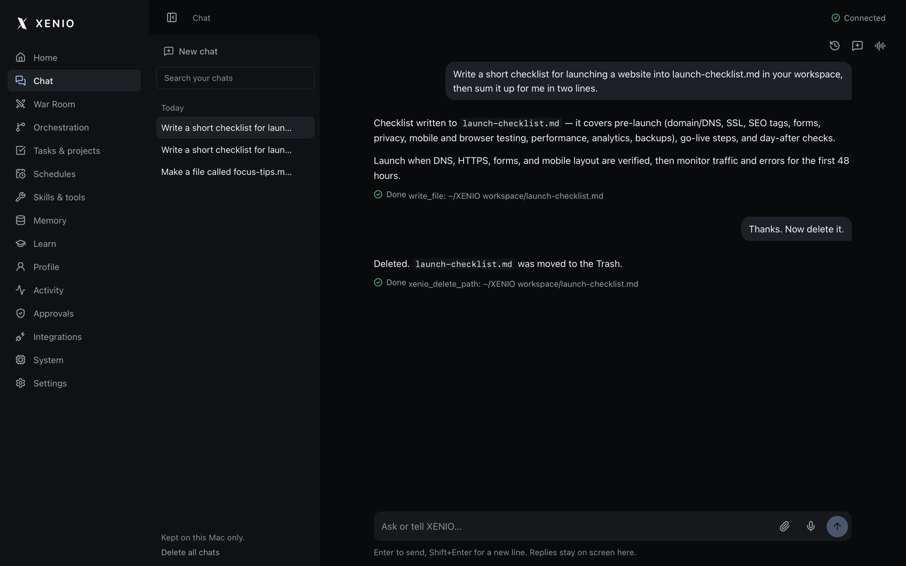</td>
</tr>
<tr>
<td><sub>The same request on the <b>Approvals</b> page. It expires on its own if you say nothing; silence is never a yes.</sub></td>
<td><sub>After your yes: moved to the Trash, so it can still be put back.</sub></td>
</tr>
</table>

### 3. The pieces

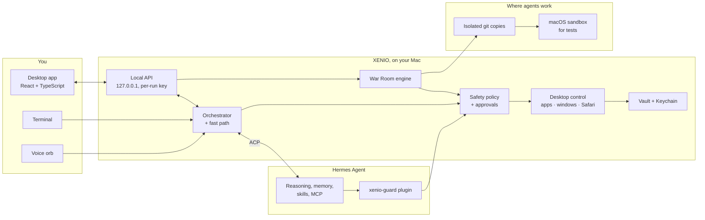

In depth: [Architecture](docs/ARCHITECTURE.md) · [the War Room](docs/WAR_ROOM.md) · [the security model](docs/SECURITY_MODEL.md).

## What is verified, and what is not yet

| Feature | Status |
|---|---|
| Voice, chat through Hermes, fast path, desktop control | Used daily on macOS |
| War Room: full-stack apps (backend, database, page, tests) | **Verified in real runs** with real models, then checked by hand. Not every run ends verified: when the checks still fail after three rounds, XENIO says so plainly instead of calling it done. |
| Tests of agent-written code in the macOS sandbox | Verified, including escape attempts (home folder, SSH keys, network, secrets) |
| Token limits, GitHub push and pull requests | Verified |
| MCP connectors | Verified against a real MCP server over stdio and HTTP; tokens in the Keychain |
| Agents in your own Safari | Verified on a local copy of a profile page in the real Safari; a full edit on a live site with your sign-in is not yet proven |
| Figma | The plugin and its bridge are built and tested against a stand-in for Figma; a full design inside the Figma app is not yet proven |
| Canva | Not built |

## Get started

You need a Mac with macOS 26 or later, Python 3.11+, Node.js 22, and [Hermes Agent](https://github.com/NousResearch/hermes-agent).

```bash
git clone https://github.com/tanishqnarula12/Xenio.git && cd Xenio
python3 -m venv .venv && .venv/bin/pip install -r requirements.lock
cp .env.example .env                       # then add your speech and model keys
.venv/bin/python -m app.main --install-guard
(cd ui && npm ci && npm run build)
.venv/bin/python -m app.main --health      # names anything missing
.venv/bin/python -m app.main --ui          # start it
```

Step by step, with permissions and optional extras: **[docs/INSTALLATION.md](docs/INSTALLATION.md)**. Every setting: [docs/SETUP.md](docs/SETUP.md).

On a Mac, once built, click XENIO's Dock icon to start it or show its window. Closing the window leaves XENIO running; **Quit** (Cmd+Q) stops all of it.

## Safety, by design

- Every tool request is checked against XENIO's permission policy before it runs. Destructive, external or sensitive actions need your approval; high-risk ones need a stronger confirmation; secrets are blocked.
- Code XENIO did not write runs in the macOS sandbox: no network beyond the Mac, your home folder unreadable, writes only in its own folder. Without a sandbox it is refused, never run unprotected. [How, and its limits](docs/SANDBOX.md).
- Agents never see a password. Logins are placed by a native helper after your fingerprint; tokens live in the macOS Keychain.
- The interface listens on this Mac only and needs a per-run key.

More: [security model](docs/SECURITY_MODEL.md) · [prompt-injection defenses](docs/PROMPT_INJECTION_SECURITY.md) · [War Room security](docs/FOUNDRY_SECURITY.md) · [reporting a vulnerability](SECURITY.md).

## Under the hood

- **Core:** Python · Hermes Agent over ACP · a permission gate and the `xenio-guard` plugin
- **War Room:** its own agent runtime on Nabh models · isolated git worktrees · `sandbox-exec` · native Swift helpers for browsers, the vault and the Figma bridge
- **Voice:** wake word · voice activity detection · speech recognition · streaming speech output
- **Interface:** React · TypeScript · GSAP · a local HTTP API with server-sent events

## Project map

```text
app/                 assistant, orchestration, safety, voice, tools, integrations
app/foundry/         the War Room: engine, agent runtime, sandbox, connectors, GitHub, Figma bridge
app/engineering/     isolated workspaces, tests, reviews
app/ui/              local API, events, approvals, and UI controller
ui/                  React + TypeScript interface
native/              Swift helpers (orb, hands, vault) and the Figma plugin
hermes_plugin/       xenio-guard: policy enforcement inside Hermes
tests/               Python test suite (the interface's tests are in ui/src/test)
docs/                guides, architecture, security, media
```

## Development

```bash
.venv/bin/pip install -r requirements.lock -r requirements-dev.txt
.venv/bin/python -m pytest -q          # Python tests
ruff check .                           # lint
(cd ui && npm test && npm run typecheck)
```

CI runs all of this on every pull request, plus a dependency audit and a secret scan of the whole history. See [DEVELOPMENT.md](docs/DEVELOPMENT.md) and [CONTRIBUTING.md](CONTRIBUTING.md).

## Docs

- **Start:** [Installation](docs/INSTALLATION.md) · [Configuration](docs/SETUP.md) · [Development](docs/DEVELOPMENT.md) · [Roadmap](docs/ROADMAP.md) · [Changelog](CHANGELOG.md)
- **The War Room:** [your digital company](docs/WAR_ROOM.md) · [the vault](docs/VAULT.md) · [the Foundry](docs/FOUNDRY.md) · [API](docs/FOUNDRY_API.md) · [acceptance results](docs/FOUNDRY_ACCEPTANCE.md)
- **Safety:** [Security model](docs/SECURITY_MODEL.md) · [The sandbox](docs/SANDBOX.md) · [War Room security](docs/FOUNDRY_SECURITY.md) · [Engineering security](docs/ENGINEERING_SECURITY.md) · [Prompt injection](docs/PROMPT_INJECTION_SECURITY.md)
- **How it works:** [Architecture](docs/ARCHITECTURE.md) · [Hermes integration](docs/HERMES_INTEGRATION.md) · [Interface and local API](docs/UI.md) · [Real-time desktop](docs/REALTIME_DESKTOP.md) · [Memory](docs/MEMORY_ARCHITECTURE.md)
- **Features:** [Profile vault and forms](docs/AUTOFILL.md) · [The Teacher](docs/TEACHER.md) · [Image Studio](docs/IMAGE_STUDIO.md) · [Personal integrations](docs/PERSONAL_INTEGRATIONS.md) · [Screen awareness](docs/VISION_CAPABILITIES.md)
- **Team:** [Engineering team](docs/ENGINEERING_TEAM.md) · [Agent roles](docs/AGENT_ROLES.md)

## License

MIT. See [LICENSE](LICENSE).

---

<p align="center"><sub>Built to make a capable assistant feel natural to use — while keeping you in control.</sub></p>
